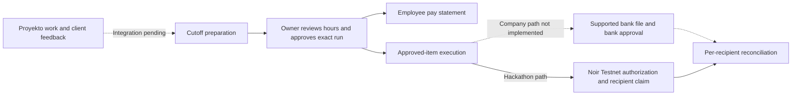

# Cordera

**Agentic Work Verification & Payment Orchestration**

**One-line pitch:** A Proyekto-connected pay-run layer that links owner-reviewed hours and client-evaluated work to employee-visible pay calculations and controlled payment execution.

**Live website:** `TBD — public deployment required`  
**Demo video (2 min):** `TBD`  
**Team:** [Stobeeney](https://github.com/Stobeeney) (Designer), [JCarloZ24](https://github.com/JCarloZ24) (Developer), [aidantiu](https://github.com/aidantiu) (Developer), [JoshuaHM-p4](https://github.com/JoshuaHM-p4) (Founder/Fullstack). **Discord handles:** TBD (do not guess).

## Problem
In our small digital services company, the consultant/owner reviews hours per employee and project for **1–15 and 16–end-of-month** cutoffs. He then opens the bank, copies each employee's account details and pay amount, sends the transfer and completes the bank's authorization steps—one employee at a time. That repetitive disbursement is the main bottleneck.

Employees also lack a clear breakdown to verify pay against hours and rates. The owner sees recorded hours and task lists without a consolidated view of actual outputs, client comments, revision requests and acceptance.

The company already uses **Proyekto** for project/client collaboration, documents, roadmaps, Gantt charts and invoicing. Rebuilding those tools is not the solution.

## Solution
Cordera targets cutoff preparation, manual owner review, employee pay transparency and approved-run execution alongside Proyekto. Milestones bundle task/deliverable evidence and client evaluations; they are not the default unit of hourly employee pay. The owner retains hours review and final release authority. The agent cannot set wages or change approved recipients and amounts.

**Current status:** the source is still a fictional, milestone-oriented starter with preview and payment adapters. Proyekto integration, cutoff review, client-evaluation history, employee statements, approved-run execution and bank payouts are **not implemented**. Live transaction proof has not been produced.

## Target workflow
1. Reference Proyekto projects, time entries and versioned deliverables. Record client comments, revision requests and acceptance against the evaluated version. Integration access still needs verification.
2. Prepare the cutoff with submitted hours, agreed rates and output context. The owner manually reviews and approves hours per employee/project.
3. Give each employee their own calculation: submitted/approved hours, rates, explained adjustments, expected pay and a discrepancy channel.
4. Owner approves an immutable pay-run version with exact verified recipients, amounts, currency/asset and total. Changes require reapproval.
5. Execute only approved items and reconcile each recipient independently. Never replay an entire partly paid run or blindly retry an uncertain transfer.

Client acceptance informs work review; it does **not** automatically determine whether hours-based wages are owed. Follow the actual compensation agreement and applicable law. Client invoice payment is separate from employee pay eligibility.

## Company path versus hackathon path
- **Company adoption:** verify the chosen bank's existing bulk-disbursement facility first, then generate its supported upload file from an approved run. Bank integration is not implemented. Preserve bank-native authorization; do not automate OTP entry or promise one authorization for every bank.
- **Hackathon demonstration:** owner provisions and funds Noir Testnet escrow, then approves explicit Testnet items. The server enforces approved recipients, amounts and run budget; the agent calls `checkPayment` then `authorizePayment`. Each merchant separately signs `claim`. Authorization is not receipt.
- **Optional client collections:** Velo checkout and signed-event reconciliation are separate from pay-run release and Noir funding. Velo's current [upstream scope](https://github.com/Velo-Ecosystem-Collection/Velo/blob/main/packages/velo-sdk/README.md#release-scope) is Testnet only, with no Mainnet or external settlement support. Neither integration sends PHP to employee bank accounts.

The differentiation to validate is work-to-payment traceability, not novel payroll rails. [BPI BizLink](https://www.bpi.com.ph/institutional-banking/cashflow-management/bizlink) already documents transaction-file upload and approval controls; [Sprout Payroll](https://sprout.ph/product/payroll-management/) documents timekeeping, employee payslips and bank-disbursement file generation. Company eligibility, costs and bank coverage need verification.

## Target architecture

This is the target, not the current implementation. See [architecture notes](docs/ARCHITECTURE.md), [PRD](PRD.md), [current API](docs/API.md) and [integration guide](docs/INTEGRATIONS.md).

## Noir integration
- Package: `@noirx402/agent-sdk` (resolved installed version **TBD after npm install**); `@stellar/stellar-sdk` v16.
- Target **deployed** contracts: `device_registry`, `agent_registry`, `payment_escrow`. The official Noir SDK is required for all calls; **no custom contracts**.
- Source: [Noir checkPayment/authorizePayment adapter](packages/agent/src/noir.ts), [decision rules](packages/agent/src/index.ts), [protected trigger](apps/server/src/index.ts).
- Setup `registerDevice`, `registerAgent`, `fundEscrow`, and merchant `claim` are **not yet implemented in this scaffold**; must be demonstrated on actual Testnet before submission.
- **Contract ID conflict warning:** earlier form IDs differ from official Nov 5 handbook and [Noir public reference](https://github.com/noirx402/noir/blob/main/docs/contracts.md). See [exact IDs / action plan](docs/INTEGRATIONS.md).
- Noir's policy caps each payment and constrains asset/expiry; it does **not** enforce a recipient allowlist or cumulative cutoff budget. Approved-item binding and aggregate limits need application-side enforcement and are not implemented by the current adapter.

## Velo integration
- This starter declares `@carts1024/velo-sdk@alpha` (resolved version unverified). The current upstream README describes stable `1.0.0`; this documentation update does not upgrade or validate the dependency. Compare actual exports before implementation.
- Checkout: [server Velo adapter](apps/server/src/payments.ts), [protected checkout endpoint](apps/server/src/index.ts).
- Raw signed webhook verification: [webhook route](apps/server/src/index.ts) using `Velo.webhooks.verify`.
- **Not complete:** durable event dedupe, retrieval/reconciliation and confirmed status writes.

## Testnet proof
**TBD — not yet claimed.** Add at least one genuine [Stellar Expert Testnet](https://stellar.expert/explorer/testnet) transaction link showing *agent authorizing payment*; ideally also link device/policy, escrow funding, and merchant claim transactions. Do not treat fixture preview as proof.

## Repo structure
```
apps/web/             React frontend + route views
apps/server/          Express API, webhook, Velo checkout
packages/agent/       Decision engine + Noir SDK adapter
packages/shared/      Cross-app types
docs/                 PRD references, UX, payment design, checklist
scripts/              Local smoke check
.github/workflows/     CI
```

## Run it locally
1. Install Node 22.23.4+ (supported 22 release) and Git; optional Noir Chrome extension / Testnet wallets for real SDK flows.
2. At root: `npm install`.
3. `cp apps/server/.env.example apps/server/.env` and keep `DEMO_MODE=true`.
4. Run `npm run dev`: web `http://localhost:5173`, server `http://localhost:4000`.
5. Run `npm run typecheck && npm test && npm run build` when dependencies installed. See full [SETUP.md](SETUP.md).

## Environment variables
| Name | What it is | Where to get it |
|---|---|---|
| `PORT`, `WEB_ORIGIN`, `PUBLIC_WEB_URL` | Server config, safe origins | Set locally / hosting |
| `DEMO_MODE` | Prevent payout/checkouts (`true` by default) | Local override |
| `ADMIN_API_TOKEN` | Temporary privileged test API token; not production login | Create random local secret |
| `VELO_API_KEY` | Velo Testnet checkout API | [Velo dashboard](https://www.velo-build.dev) |
| `VELO_WEBHOOK_SECRET` | Velo signature verification | Velo webhook config |
| `NOIR_DEVICE_HASH` | Official linked device hash | Owner-created with Noir SDK |
| `NOIR_AGENT_PUBLIC_KEY` | Delegated Testnet agent address | Agent keypair |
| `NOIR_AGENT_SECRET` | Delegated Testnet signer **server only** | Agent keypair (never commit) |
| `ALLOWED_MERCHANT_ADDRESSES` | Verified merchant wallet allowlist | Operator-approved addresses |
| `VITE_API_BASE` | Public API server origin for split deployments | Set on web host; empty for dev proxy |

## Screenshots
**TBD:** owner cutoff review, employee calculation/discrepancy view, exact-run approval, per-recipient status, separate Velo collection, and genuine Noir authorization/claim proof. These are target screenshots, not claims that the screens exist. Do not use fake receipts.

## Implementation priorities
Build the Proyekto-linked cutoff/review model, versioned client evaluations, private employee statements and immutable owner approval first. Add authenticated, durable per-item execution and reconciliation before exposing money-moving controls. Demonstrate owner-approved Testnet execution and merchant claim through Noir; demonstrate Velo collection separately, not as automatic payroll funding.

For company use, evaluate supported bank bulk-disbursement and existing payroll tools before building a custom bank API. Actual bank execution and production payroll compliance remain outside the Testnet hackathon scope. Brand styling stays on hold until Prodigitality approves it.

## Credits
Official project repos: [Noir](https://github.com/noirx402/noir) and [Velo](https://github.com/Velo-Ecosystem-Collection/Velo). SDK integration patterns follow the *Velo x Noir Agentic Payment Hackathon — Builder Handbook*, updated Nov 5, 2026. Uses React, Vite, Tailwind, Express, TypeScript and Stellar. Concept adapted for [Prodigitality](https://prodigitality.net/services). All code in this starter is a fresh scaffold, not a clone of either vendor repo.

> **Starter validation note (Nov 5, 2026):** structural and JSON checks passed with `npm run check:scaffold`. Full dependency installation, TypeScript build, live Noir/Velo integration, and deployment have **not** been verified in this environment. Run the required commands on a supported Node version and treat missing integration work as open tasks.
