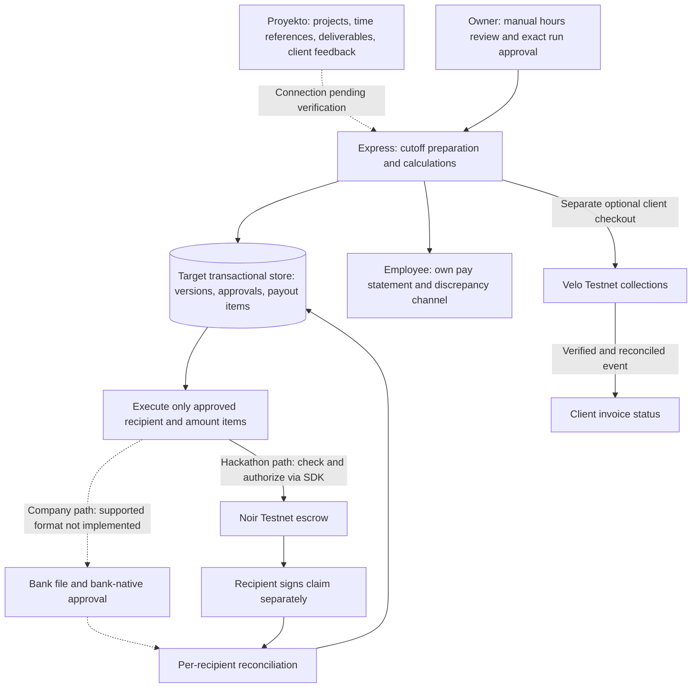

# Architecture and boundaries

## Target logical structure — not the current starter implementation


Proyekto remains the project/client-collaboration and invoicing system; its integration method is not verified. Snapp adds reviewed cutoff calculations, approval and payment traceability. The diagram is a target, not evidence of working integration, bank transfers or pay-run execution.

The existing source remains a fictional project/milestone preview with JSON demo persistence, Velo adapters and a protected milestone-triggered Noir adapter. It has no cutoff approval snapshot, reviewed-hours workflow, employee statements or Proyekto/bank integration. See [current API limitations](API.md).

Velo collections and Noir escrow are independent. Velo does not invoke Noir, fund its escrow automatically, or disburse PHP to employees. Its [upstream release scope](https://github.com/Velo-Ecosystem-Collection/Velo/blob/main/packages/velo-sdk/README.md#release-scope) states Testnet only, no Mainnet and no settlement support.

## Source directory boundaries
```
apps/web/                # UI routes, presentational components, API fetch; NEVER secrets
apps/server/             # HTTP endpoints, authentication, webhooks, persistence, orchestration
packages/agent/          # Eligibility evaluator, Noir SDK abstraction, payment action
packages/shared/         # Public API types and validation schemas
scripts/                 # Local smoke and reproducible demo scripts
```

## Target review and approval boundary
1. Reference Proyekto work/time records and deliverable versions with provenance; retain client comments, revision requests and acceptance identity/time/version.
2. Prepare a 1–15 or 16–end-of-month cutoff. The owner manually reviews hours per employee/project; client acceptance is separate from hours approval.
3. Calculate from versioned agreed terms, approved hours and reasoned adjustments using exact money arithmetic. Show each employee their own calculation and discrepancy history.
4. Owner approves an immutable run snapshot: input versions, exact recipients, amounts, currency/asset, total and authorization scope. A change requires reapproval, not silent mutation.
5. Reserve each approved payout item transactionally, enforce the remaining approved-run budget and prevent overlapping/duplicate payment. Export or submit only those fixed items.
6. Reconcile per-recipient results. Partial failures never justify replaying a whole run; uncertain results block resubmission of the affected item until resolved.

Hours-based employee pay follows the actual agreement and applicable law. Missing client acceptance, revisions or an unpaid invoice must not automatically become a wage-withholding rule. Milestones are evidence bundles; fixed-fee milestone contracting may have separately agreed release conditions.

## Required Noir order — target hackathon path
1. Owner uses the official SDK plus Noir extension or wallet signer to `registerDevice` (hash of card UID).
2. Owner calls `registerAgent` with the correct agent key, asset, per-payment cap and expiry.
3. Owner calls `fundEscrow` with native Testnet XLM. This is independent of Velo.
4. Owner reviews hours and approves explicit Testnet demonstration items; PHP amounts never imply an exchange rate.
5. Server binds the request to the approved snapshot, verifies recipient, amount, app-side run budget and idempotency reservation.
6. Agent calls `checkPayment`; only if all checks pass, it calls `authorizePayment` with the **server-held agent key**. The agent cannot set wages or change approved recipients/amounts.
7. Merchant signs `claim`. Record authorization and claim separately; only verified claim is recipient settlement on Testnet, not a bank credit.
8. Unlink safely: revoke agent → sweep/defund as appropriate → revoke device. Never revoke a device with escrow funds remaining.

Owner setup, approved-run execution and merchant claim orchestration are not implemented by the current adapter.

## Company bank path — not implemented
Verify the selected bank's bulk-disbursement facility, recipient coverage, file format, fees, schedules and approval rules first. Generate its supported file from an approved run, preserve bank-native authorization, then reconcile each employee's bank result/reference. Consider an API only after access and capabilities are confirmed.

Never automate bank UI/OTP entry, hold online-banking credentials, promise a single OTP, or treat file generation/upload as confirmed payment. Real bank execution is outside this repository's Testnet scope.

## Velo order — separate client collections
1. Link a client invoice reference and create a checkout for an explicit Testnet asset amount.
2. Client pays using Velo checkout.
3. Server verifies the raw-body signature before accepting the event.
4. Transactionally dedupe the event, retrieve the payment intent and reconcile status before confirming the invoice.
5. Keep invoice collection independent of pay-run eligibility, Noir funding, authorization and merchant claim.

The current starter does not implement durable event reconciliation or confirmed invoice-state writes.

## High-risk payment conditions
- No execution without authorized hours review, an approved immutable item and a verified recipient.
- Noir policy does **not** constrain merchants or cumulative cutoff totals. Enforce allowlists, run/item binding and aggregate budget app-side; per-payment caps alone do not constrain a run.
- Block expired policies, wrong assets, insufficient funds, duplicate attempts, stale approvals and disputed/changed payout items.
- Evidence checks follow the actual compensation agreement; they must not silently introduce client-acceptance conditions for wages.
- Retain uncertain transactions as `PENDING_RECONCILIATION`; recover their existing identity, never blindly retry with a fresh nonce.
- JSON demo storage is not atomic or concurrency-safe. Use durable transactions, unique obligation/item identities and serialized execution before multiuser or exposed Testnet payment use.

## Deployment topology
- Web: static host with SPA history fallback (`/projects/...`). `VITE_API_BASE` if using separate domain; current Vite development proxy only works locally.
- Server: persistent Node/Express host with HTTPS at `https://<api-host>/api/webhooks/velo`.
- Set CORS to real web origin; configure `PUBLIC_WEB_URL`; secret environment vars only on server host.
- For deployment, replace dev proxy with production API base config or a frontend host rewrite to the server. Do not deploy current localhost proxy unchanged.

## Production boundary
The company adoption path requires a verified bank/provider arrangement, employment/payroll compliance review, authentication/RBAC, transactional persistence, audit records, sensitive-data protection and reliable reconciliation. None is established by Testnet proof. Keep actual payroll/customer data out of the public demo; do not represent the current starter as production payroll.
