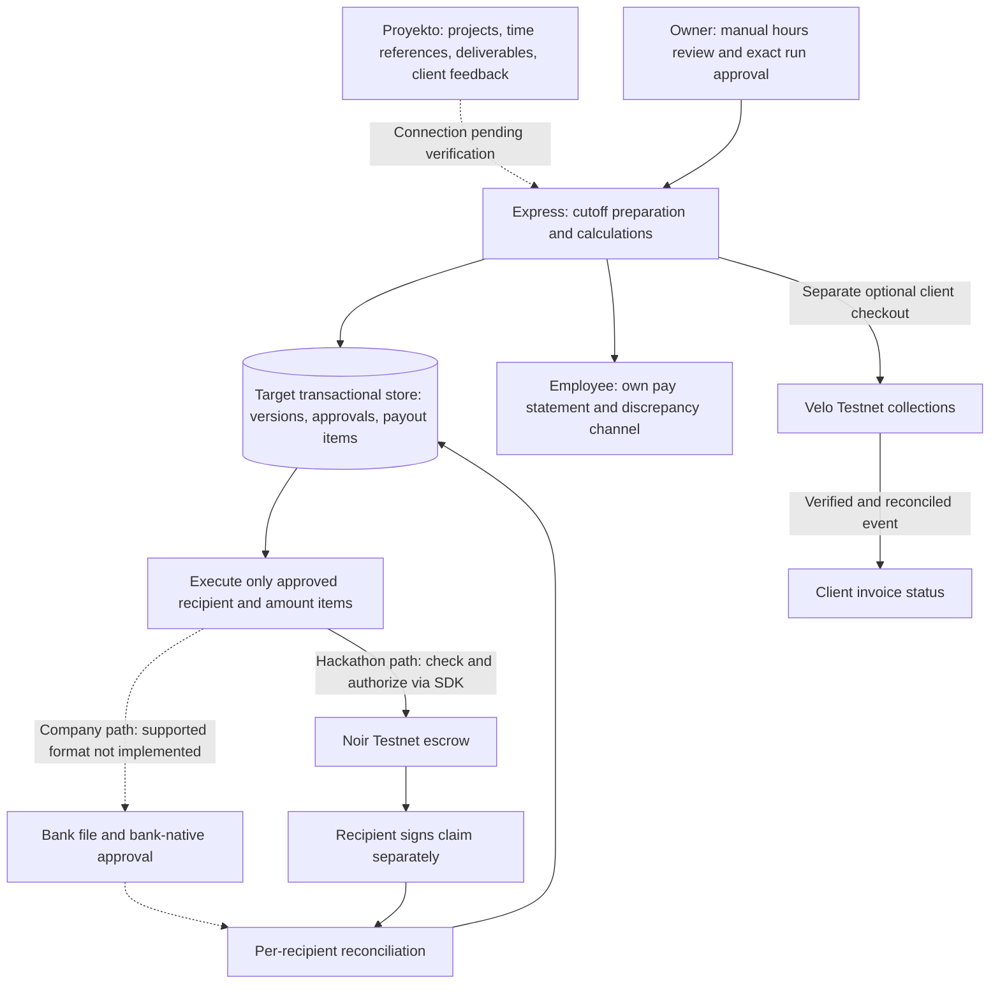

# Architecture and boundaries

## Target logical structure — not the current starter implementation


Proyekto remains the project/client-collaboration and invoicing system; its integration method is not verified. Snapp adds reviewed cutoff calculations, approval and payment traceability. The diagram is a target, not evidence of working integration, bank transfers or pay-run execution.

Current source has fictional project/milestone previews, read-only fixture data and independent Velo adapters, plus a separate controlled **local Noir Testnet CLI**. The former HTTP milestone approval route is removed (404), with no replacement. Shared eligibility and already-submitted `paymentHash` rules remain for previews. There is no cutoff approval snapshot, reviewed-hours workflow, employee statement, authentication/RBAC or Proyekto/bank integration. See [current API limitations](API.md).

Velo collections and Noir escrow are independent. Velo does not invoke Noir, fund its escrow automatically, or disburse PHP to employees. Its [upstream release scope](https://github.com/Velo-Ecosystem-Collection/Velo/blob/main/packages/velo-sdk/README.md#release-scope) states Testnet only, no Mainnet and no settlement support.

## Source directory boundaries
```
apps/web/                # UI routes, presentational components, API fetch; NEVER secrets
apps/server/             # Fixture reads/previews, protected Velo checkout, raw signed webhook
packages/agent/          # Eligibility evaluator, local Noir SDK CLI, consent and SQLite journal
packages/shared/         # Public API types and validation schemas
scripts/                 # Local smoke and reproducible demo scripts
```

## Target review and approval boundary
1. Reference Proyekto work/time records and deliverable versions with provenance; retain client comments, revision requests and acceptance identity/time/version.
2. Prepare a 1–15 or 16–end-of-month cutoff. The owner manually reviews hours per employee/project; client acceptance is separate from hours approval.
3. Calculate from versioned agreed terms, approved hours and reasoned adjustments using exact money arithmetic. Show each employee their own calculation and discrepancy history.
4. Owner approves an immutable run snapshot: input versions, exact recipients, amounts, currency/asset, total and authorization scope. A change requires reapproval, not silent mutation.
5. Reserve each approved payout item transactionally, enforce the remaining approved-run budget and prevent overlapping/duplicate payment. Export or submit only those fixed items.
6. Reconcile per-recipient results. Partial failures never justify replaying a whole run; uncertain results block resubmission of the affected item until resolved.

Hours-based employee pay follows the actual agreement and applicable law. Missing client acceptance, revisions or an unpaid invoice must not automatically become a wage-withholding rule. Milestones are evidence bundles; fixed-fee milestone contracting may have separately agreed release conditions.

## Controlled local Noir boundary — implemented, live proof unverified
Use `npm run noir -- <command>`; [SETUP](../SETUP.md) specifies the complete role-separated sequence. This is a single-item experiment, not the target hours-review/pay-run workflow:
1. `doctor` checks pinned SDK 0.3.0, fixed Testnet contracts/network and attestation readiness. `plan --manifest` normalizes exact public values and computes the approval digest offline.
2. Owner privately supplies only the owner secret to `approve --confirm <digest>`. Consent signs the exact manifest, native asset, network passphrase and contract IDs; altered inputs require new explicit approval.
3. Owner runs separate `setup --step device|policy|fund` commands in order, using SDK `registerDevice`, `registerAgent`, `fundEscrow`. Existing exact setup can be reused; conflicts fail. There is no automatic wallet generation/funding or Velo bridge.
4. `check` inspects approval, policy, asset, escrow and merchant pending balance. `authorize` enforces signed item binding, independent allowlist, per-payment limits and cumulative-device reservations, then SDK `checkPayment` before preparing/signing/submitting `authorize`. The agent cannot set wages or substitute recipients.
5. Merchant separately signs `claim` after locally confirmed authorization and explicit positive aggregate `--pending-stroops` confirmation. This collects **all** merchant/token pending funds, not one claim per item. Already-authorized collection is allowed after expiry; new setup/approval/authorization is not.
6. `reconcile` reads existing hashes without sending; `evidence` separates transaction identity, confirmation and matching authorization/claim events. Neither zero pending nor an aggregate claim alone proves one payroll item settled.
7. **Snapp Autopilot** (`assess`, `autopilot`): the agent decides *whether and when* an owner-approved item executes. The Payment Eligibility Engine (deterministic: approval valid, recipient/amount identical to the signed manifest, `evaluateMilestone` passes, payout date reached, not disabled, live device/policy/escrow/`checkPayment` agree) runs first. Only then the Payout Risk & Review Agent (Jev via Vercel AI SDK `experimental_decide`: direct `@ai-sdk/typesafe-ai` pinned to `jev-1.14.0`, or AI Gateway `typesafe-ai/jev`) classifies the review text as `routine|pending|escalate` plus an unresolved-concern probability. Verdicts are `EXECUTE`, `DEFER` (retry later; also whenever Jev is unavailable) or `ESCALATE` (human). Jev can only tighten; `EXECUTE` reuses the step 4 `authorize` path unchanged. Every verdict is appended to an immutable `decisions` table. `SNAPP_AUTOPILOT_DISABLED=true` halts new executions.

Every chain write requires `--live`, exact digest confirmation, local signed consent, the acting role's inherited secret and `NOIR_TESTNET_CONTRACTS_CONFIRMED=true` after **independent organizer/deployment verification**. Three distinct Testnet roles need manual fee funding and verified merchant consent/allowlisting. No secrets in browser, server `.env`, command arguments, logs or chat. All contract operations use the official SDK; Stellar SDK 16.0.1 is only the signing/inspection boundary. No custom contracts, Mainnet or configurable RPC/contract overrides.

The canonical journal is repository-root `.data/noir-testnet.sqlite`, independent of cwd; `--db` is an explicit alternative, not a second deduplication domain. A SQLite lock spans validation, exact BigInt cumulative-device budget reservation, SDK preparation and signing. Hash/operation/nonce are committed **before broadcast**. Prepared/unknown/succeeded authorizations remain reserved; timeout/NOT_FOUND does not release budget. Every recorded operation is irreversible locally: no retry/reset/replacement nonce, including failed operations. Copying/deleting journals defeats local deduplication. This is not a payroll obligation ledger or authenticated multiuser database.

Exercised: SDK/source/network agreement, 20 focused Noir tests, all 21 workspace tests, scaffold checks, agent typecheck, offline CLI/SDK persistence smoke and actual server/browser preview. Root typecheck and full build pass (33 tests). Velo reconciliation exercised locally with self-signed events only. The earlier form-ID discrepancy remains unresolved despite SDK/repository agreement. Live setup/authorization/claim and deployment remain unverified; safe revoke/defund/unlink automation is not included. See [verification details](CHECKLIST.md#exercised-controlled-tooling-checks--not-live-gates).

## Company bank path — not implemented
Verify the selected bank's bulk-disbursement facility, recipient coverage, file format, fees, schedules and approval rules first. Generate its supported file from an approved run, preserve bank-native authorization, then reconcile each employee's bank result/reference. Consider an API only after access and capabilities are confirmed.

Never automate bank UI/OTP entry, hold online-banking credentials, promise a single OTP, or treat file generation/upload as confirmed payment. Real bank execution is outside this repository's Testnet scope.

## Velo order — separate client collections
1. Link a client invoice reference and create a checkout for an explicit Testnet asset amount.
2. Client pays using Velo checkout.
3. Server verifies the raw-body signature before accepting the event.
4. Transactionally dedupe the event, retrieve the payment intent and reconcile status before confirming the invoice.
5. Keep invoice collection independent of pay-run eligibility, Noir funding, authorization and merchant claim.

The current starter does not implement durable event reconciliation or confirmed invoice-state writes.

## High-risk payment conditions
- For target payroll execution, require authorized hours review, an approved immutable run item and a verified recipient; local experiment consent is not hours approval.
- Noir policy does **not** constrain merchants or cumulative cutoff totals. Enforce allowlists, run/item binding and aggregate budget app-side; per-payment caps alone do not constrain a run.
- Block expired policies for new authorizations, wrong assets, insufficient funds, duplicate attempts, stale approvals and disputed/changed payout items; do not strand previously authorized merchant funds merely because policy/approval expired.
- Evidence checks follow the actual compensation agreement; they must not silently introduce client-acceptance conditions for wages.
- Retain uncertain local operations as `unknown`; reconcile their persisted identity, never blindly retry with a fresh nonce.
- Fixture JSON is not a payout store. The local SQLite experiment journal does not supply target multiuser run records, obligation identities, login/RBAC or payroll reconciliation; these still require design and implementation before exposed payment execution.

## Deployment topology
- Web: static host with SPA history fallback (`/projects/...`). `VITE_API_BASE` if using separate domain; current Vite development proxy only works locally.
- Server: persistent Node/Express host with HTTPS at `https://<api-host>/api/webhooks/velo`.
- Set CORS to real web origin; configure `PUBLIC_WEB_URL`; Velo/admin secrets only on server host. Noir role secrets stay in private local operator shells, outside web/server deployment configuration.
- For deployment, replace dev proxy with production API base config or a frontend host rewrite to the server. Do not deploy current localhost proxy unchanged.

## Production boundary
The company adoption path requires a verified bank/provider arrangement, employment/payroll compliance review, authentication/RBAC, transactional persistence, audit records, sensitive-data protection and reliable reconciliation. None is established by Testnet proof. Keep actual payroll/customer data out of the public demo; do not represent the current starter as production payroll.
